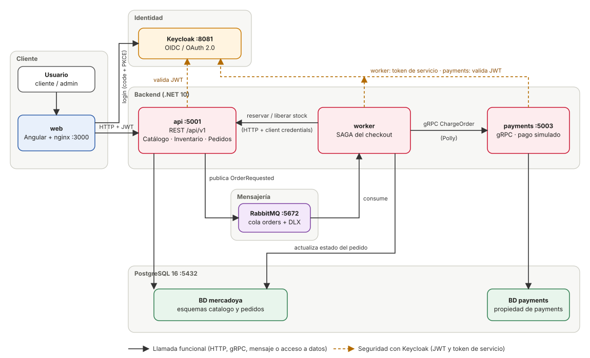

# MercadoYa — Diagrama general de arquitectura

> **Estado:** propuesta de diseño (borrador v2, alineada con el Acta de Constitución: entrega 14/12/2026, 120 h). Todavía no está implementada.
> **Cambios v2:** categorías jerárquicas y filtro por `categoryId`; `payments` valida JWT contra Keycloak (conexión 12), registro de clientes, seguimiento del pedido por enlace, mapeo de roles/audience y regla del issuer en Docker.
> **Documentos relacionados:** [`secuencia-checkout-saga.md`](./secuencia-checkout-saga.md) · carpeta `contracts/` (contratos congelados el día 1).

## 1. Diagrama



**Cómo leerlo**

- Línea continua: llamada funcional (HTTP, gRPC, mensaje o acceso a datos).
- Línea punteada: interacción de seguridad con Keycloak (validación de JWT y token de servicio).
- Camino del checkout: `web` → `api` → RabbitMQ → `worker` → (stock en `api`, cobro en `payments`) → estado final en la BD de pedidos.

**Cómo editarlo:** el diagrama es un SVG (`arquitectura-general.svg`) y se puede abrir en cualquier navegador, editor de texto o herramienta vectorial (Inkscape, Figma, draw.io).

## 2. Estilo arquitectónico

**Monolito modular más dos piezas satélite.**

- `api` es un monolito modular: tres módulos (Catálogo, Inventario y Pedidos) con fronteras claras dentro de un mismo despliegue.
- `worker` y `payments` se separan porque aportan valor técnico concreto: mensajería asíncrona y comunicación gRPC con base de datos propia.
- Se evita deliberadamente una arquitectura de microservicios completa: el equipo es de 2 personas y el plazo es de 15 días.

## 3. Componentes

| Componente | Tecnología | Puerto | Responsabilidad | Dueño |
|---|---|---|---|---|
| **web** | Angular (standalone, signals) servido con nginx | 3000 | Tienda pública (`/tienda`) y panel de administración (`/admin`, carga diferida). Login, guards por rol, polling del estado del pedido y seguimiento por enlace directo (`/tienda/pedido/:id`) | Ambos (A: catálogo y admin de productos; B: carrito, checkout y admin de pedidos) |
| **api** | .NET 10, REST `/api/v1` | 5001 | Expone el catálogo, el ABM de productos, los pedidos y los endpoints internos de stock. Valida JWT. Publica `OrderRequested` | A (Catálogo e Inventario) y B (Pedidos) |
| **worker** | .NET 10, `BackgroundService` | — | Consume `OrderRequested` y orquesta la SAGA: reserva stock, cobra, confirma o compensa | B |
| **payments** | .NET 10, gRPC | 5003 | Cobro simulado e idempotente por `orderId`. Base de datos propia | A |
| **Keycloak** | Keycloak 26 | 8081 | Servidor de identidad (OIDC / OAuth 2.0): login, auto-registro de clientes, roles `admin` y `cliente`, clients de servicio | A |
| **RabbitMQ** | RabbitMQ 4 | 5672 (AMQP) / 15672 (consola) | Broker: exchange, cola durable `orders`, DLX y cola `.dead` | B |
| **PostgreSQL** | PostgreSQL 16 | 5432 | BD `mercadoya` (esquemas `catalogo` y `pedidos`) y BD `payments` | A y B |

## 4. Módulos internos de la `api`

| Módulo | Esquema | Responsabilidad principal | Dueño |
|---|---|---|---|
| **Catálogo** | `catalogo` | Productos y árbol de categorías (`ParentId`): listado, búsqueda, filtro por categoría (con descendientes), paginación, detalle y ABM (baja lógica). Alimenta el mega menú de la web | A |
| **Inventario** | `catalogo` | Stock, movimientos (`StockMovement`) y reservas (`StockReservation`) con operaciones atómicas e idempotentes | A |
| **Pedidos** | `pedidos` | Creación del pedido, máquina de estados, consulta por cliente y administración | B |

Los módulos se comunican por interfaces y por identificadores, nunca consultando las tablas de otro esquema.

## 5. Conexiones entre componentes

| # | Origen → Destino | Protocolo | Autenticación | Propósito |
|---|---|---|---|---|
| 1 | web → Keycloak | HTTPS (OIDC, Authorization Code + PKCE) | Client público `web` | Iniciar sesión y obtener el JWT |
| 2 | web → api | HTTP/REST | `Authorization: Bearer <JWT>` (excepto catálogo público) | Catálogo, pedidos y administración |
| 3 | api → Keycloak | HTTP (JWKS / discovery) | — | Obtener claves para validar firma, issuer y audience |
| 4 | api → PostgreSQL | TCP (EF Core) | Usuario de BD | Persistencia de catálogo, inventario y pedidos |
| 5 | api → RabbitMQ | AMQP (publisher confirms) | Usuario del broker | Publicar `OrderRequested` |
| 6 | RabbitMQ → worker | AMQP (consumo con ack manual, prefetch 1) | Usuario del broker | Entregar pedidos a procesar |
| 7 | worker → Keycloak | HTTP (client credentials) | Client `orders-worker` | Obtener token de servicio |
| 8 | worker → api | HTTP (`/internal/v1/stock/**`) | Bearer del client `orders-worker` (claim `azp`) | Reservar y liberar stock |
| 9 | worker → payments | gRPC (`ChargeOrder`) | Bearer del client `orders-worker` | Cobrar el pedido |
| 10 | worker → PostgreSQL | TCP (EF Core) | Usuario de BD | Actualizar el estado del pedido |
| 11 | payments → PostgreSQL | TCP (EF Core) | Usuario de BD | Registrar cada pago (`PaymentRecord`) |
| 12 | payments → Keycloak | HTTP (JWKS / discovery) | — | Obtener claves para validar el Bearer del worker (firma, issuer, audience y `azp`) |

Las llamadas 8 y 9 van protegidas con Polly (timeout, reintentos con backoff y circuit breaker).

## 6. Seguridad

| Recurso | Acceso |
|---|---|
| `GET /api/v1/products`, `GET /api/v1/categories` | Público |
| `POST /api/v1/orders`, `GET /api/v1/orders/{id}` | Rol `cliente`. El `userId` sale del claim `sub` del token, nunca del cuerpo. Cada cliente ve solo sus pedidos |
| ABM de productos, `PATCH .../stock`, `GET /api/v1/admin/orders`, `PATCH .../admin/orders/{id}/status` | Rol `admin` |
| `/internal/v1/stock/**` | Solo el client de servicio `orders-worker` |
| gRPC `Payments.ChargeOrder` | Solo el client de servicio `orders-worker` |

- Toda validación de token comprueba **firma, issuer, audience y rol**.
- Las contraseñas solo existen en Keycloak.
- **Registro de clientes:** el realm `mercadoya` habilita el auto-registro (rol `cliente` por defecto). Los usuarios `admin` se crean a mano o por seed del realm.
- **Roles y audience:** Keycloak entrega los roles en `realm_access.roles` y no agrega el audience por sí solo; hay que configurar un *mapper* de audience en el realm y mapear los roles a claims en .NET.
- **Issuer en Docker:** el navegador accede a Keycloak por `localhost:8081` y los servicios por el nombre de red interno. Para que el issuer del token coincida, se fija `KC_HOSTNAME` y el `Authority`/`ValidIssuer` de cada servicio al mismo valor; se resuelve el día 1.
- Secretos y cadenas de conexión van por variables de entorno, nunca en el repositorio.

## 7. Datos

- **BD `mercadoya`:** esquema `catalogo` (Category, Product, StockMovement, StockReservation) y esquema `pedidos` (Order, OrderItem). Cada módulo tiene su propio `DbContext` y sus migraciones.
- **BD `payments`:** `PaymentRecord` con `OrderId` único. Es propiedad exclusiva del servicio de pagos (*base de datos por servicio*).
- Importes en centavos (`long`).
- **Consistencia:** el stock es consistente (se resuelve con una transacción en la base de datos). El resultado final del pedido es **eventualmente consistente**: entre el `202 Accepted` y el estado final hay una ventana asíncrona. Detalle en [`secuencia-checkout-saga.md`](./secuencia-checkout-saga.md).

## 8. Comportamiento ante fallos y puntos únicos de falla (SPOF)

| Si cae… | Sigue funcionando | Se degrada |
|---|---|---|
| **Keycloak** | Catálogo público; tokens vigentes mientras no expiren (las claves de firma quedan en caché) | No hay logins ni registros nuevos ni tokens de servicio nuevos (el worker no puede reservar ni cobrar y los pedidos pasan a `StockNoDisponible`) |
| **RabbitMQ** | Catálogo y panel de administración | Crear pedidos responde 503 (pedido rechazado por `BrokerNoDisponible`). Los mensajes ya encolados se conservan (cola durable) |
| **payments** | Catálogo, administración y aceptación de pedidos (202) | Tras agotar reintentos o abrir el circuit breaker, los pedidos terminan Rechazados (`PagoNoDisponible`) y el stock se libera |
| **worker** | Catálogo y administración | Los pedidos quedan Pendiente hasta que el worker vuelve; luego se procesan |
| **api** | Solo los archivos estáticos de `web` | Todo lo demás. Es *stateless*, por lo que se mitiga con réplicas |
| **PostgreSQL** | — | Cae todo. Es un SPOF aceptado para la demostración local (en producción se mitigaría con réplica y respaldos) |

## 9. Escalabilidad

- **api:** sin estado; escala horizontalmente con réplicas detrás de un balanceador. La caché de catálogo vive en memoria de cada réplica, por eso usa un TTL corto (30–60 s) además de la invalidación al editar.
- **worker:** escala con réplicas como **consumidores competidores** sobre la misma cola. La idempotencia por `orderId` evita procesar dos veces.
- **payments:** sin estado; escala con réplicas gracias a la idempotencia por `orderId`.
- **PostgreSQL:** escala vertical en el alcance de este proyecto.

## 10. Observabilidad

- Health checks: `/health/live` y `/health/ready` en `api` y `payments`; healthchecks de Docker en todos los contenedores.
- Logs estructurados con Serilog.
- `X-Correlation-Id` viaja de punta a punta: HTTP → header del mensaje de RabbitMQ → metadata gRPC.

## 11. Despliegue local

Todo se levanta con Docker Compose:

```bash
docker compose up -d --build
```

| Servicio | URL |
|---|---|
| Tienda y panel admin | <http://localhost:3000> |
| API (Swagger) | <http://localhost:5001/swagger> |
| Keycloak | <http://localhost:8081> |
| Consola de RabbitMQ | <http://localhost:15672> |

Las URLs y puertos son los acordados en `contracts/`; si cambian allí, se actualizan aquí.

## 12. Relación con los temas de la cursada

| Elemento del diagrama | Tema |
|---|---|
| REST `/api/v1`, ProblemDetails, caché | REST robusto, versionado, caché (Prog. IV, clase 12) |
| Keycloak, JWT, client credentials | Autenticación y autorización, OAuth 2.0 (Prog. IV, clases 13 y 15) |
| RabbitMQ y worker | Comunicación asíncrona, desacoplamiento, resiliencia (clases 16 a 18) |
| `payments` por gRPC | RPC y gRPC (clase 11) |
| Polly | Circuit Breaker y Retry (clase 21) |
| SAGA del worker | Transacciones distribuidas, patrón SAGA (clase 22) |
| Docker Compose y healthchecks | Contenerización y observabilidad (clases 10 y 23) |
| Monolito modular + satélites | Monolito modularizado vs microservicios (clases 20 y 21) |
| Tabla de fallos y SPOF | Fallos parciales, SPOF, escalabilidad y CAP (clases 3 y 9) |
