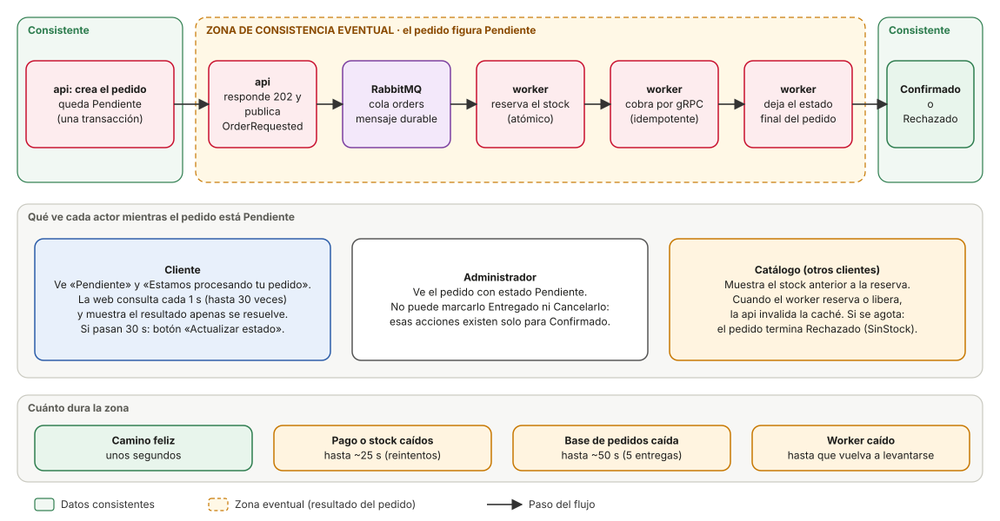

# MercadoYa — Consistencia eventual en el checkout

Qué datos son siempre consistentes, cuál es la **zona de consistencia eventual**, qué ve cada usuario mientras dura y cómo se garantiza que termine bien.
Es la contracara de elegir un checkout asíncrono: la compra no se resuelve dentro de la request, sino un instante después, en el `worker`.

**Documentos relacionados:** [`secuencia-checkout-saga.md`](./secuencia-checkout-saga.md) (pasos y compensaciones) · [`mensajeria.md`](./mensajeria.md) (RabbitMQ) · [`pruebas-de-fallo.md`](./pruebas-de-fallo.md) (cómo se comprobó).

## 1. Resumen

| Dato | Consistencia | Cómo se logra |
|---|---|---|
| **Stock** | **Fuerte**: nunca se vende dos veces la misma unidad | Una sola actualización atómica en la base (`UPDATE ... SET stock = stock - n WHERE stock >= n`) dentro de una transacción |
| **Un cobro por pedido** | **Fuerte** | `PaymentRecord` con `OrderId` único en la base de `payments` |
| **Un solo estado final por pedido** | **Fuerte** | Cambio de estado condicional: `UPDATE ... WHERE Status = 'Pendiente'`. Si dos workers compiten, gana uno |
| **Resultado del pedido** (Confirmado o Rechazado) | **Eventual** | Lo decide el `worker` después de responder `202 Accepted` |
| **Stock que muestra el catálogo** respecto de pedidos en vuelo | **Eventual** (ventana corta) | La reserva ocurre en el worker; hasta entonces el catálogo muestra el stock anterior |

La regla del diseño: **el stock y el cobro nunca se contradicen; lo único que puede llegar "tarde" es la respuesta final al cliente**.

## 2. La zona de consistencia eventual

Empieza cuando la `api` responde `202 Accepted` y termina cuando el worker deja el pedido en su estado final. Durante ese lapso el pedido figura **Pendiente**.

**Cómo leerlo:** lo que está dentro del recuadro punteado es la zona eventual. Antes de ella (crear el pedido) y después (estado final) los datos son consistentes. Debajo del gráfico se resume qué ve cada actor y cuánto dura, y las tablas siguientes lo detallan.

**Cómo editarlo:** es un SVG (`consistencia-eventual.svg`); se abre en cualquier navegador, editor de texto o herramienta vectorial (Inkscape, Figma, draw.io).

### Qué ve cada actor mientras el pedido está Pendiente

| Actor | Qué ve | Es un problema? |
|---|---|---|
| **Cliente** (seguimiento del pedido) | Estado `Pendiente`, con el mensaje "Estamos procesando tu pedido… Se actualiza solo cada 1 segundo" | No: es el estado esperado; la pantalla consulta sola hasta el resultado |
| **Administrador** (lista de pedidos) | El pedido con estado `Pendiente`. No puede marcarlo Entregado ni Cancelado: esas acciones solo existen para pedidos Confirmados | No: evita tocar un pedido que todavía se está resolviendo |
| **Otro cliente** (catálogo) | El stock **anterior** a la reserva. Puede agregar al carrito el último producto aunque otro pedido ya lo esté por reservar | Puede terminar Rechazado por `SinStock`, y es correcto: gana quien reserva primero. Ver §4 |
| **Base de datos** | Pedido `Pendiente`, sin reserva de stock ni pago todavía | No hay efectos a medias que deshacer: cada paso es idempotente |

El catálogo se refresca apenas el worker reserva o libera stock: en ese momento la `api` invalida su caché (`CatalogChanged()`), así que la ventana del catálogo dura lo que tarda el worker en llegar a la reserva, no los 60 s del TTL de la caché.

## 3. Cuánto dura

No es un valor fijo, depende de qué pase. En el camino feliz son unos segundos (el worker toma el mensaje de inmediato). Los casos con fallos están acotados por los parámetros del sistema:

| Situación | Cuánto puede durar el estado Pendiente | De dónde sale |
|---|---|---|
| Camino feliz | Unos segundos | Reservar + cobrar + confirmar |
| Pago o stock lentos o caídos | Hasta unos 20–25 s en el peor caso | 3 reintentos con timeout de 5 s por intento y backoff; con el circuit breaker abierto falla enseguida |
| Base de pedidos no disponible un momento | Hasta ~50 s | Se devuelve el mensaje a la cola con una pausa de 10 s, hasta 5 entregas (`x-delivery-limit`) |
| **Worker caído** | **Hasta que vuelva a levantarse** | La cola es durable: el mensaje espera sin perderse |
| RabbitMQ caído **al crear el pedido** | No hay ventana | La `api` no logra publicar: marca el pedido Rechazado (`BrokerNoDisponible`) y responde 503 al instante |

## 4. Cómo se maneja desde la web

El seguimiento (`/tienda/pedido/:id`) consulta el pedido **cada 1 segundo, hasta 30 veces** mientras siga Pendiente:

- **Resuelto** (Confirmado, Rechazado…): deja de consultar y muestra el resultado. Si terminó Rechazado después de haber estado Pendiente, **restaura el carrito** que se vació al aceptar el pedido, para que el cliente pueda reintentar.
- **Falla la conexión** mientras consulta: reintenta (hasta 3 fallos seguidos) y avisa "Se perdió la conexión, reintentando".
- **Pasan los 30 s sin resultado:** avisa "Tu pedido sigue en proceso y está tardando más de lo normal. No se perdió" y ofrece el botón **Actualizar estado**. El pedido no se pierde: sigue en la cola, o el worker está caído.
- **Doble clic o reintento de la compra:** el header `Idempotency-Key` hace que repetir el `POST` devuelva el mismo pedido, sin duplicarlo.
- El pedido se puede volver a consultar más tarde desde su enlace directo.

## 5. Por qué el resultado final es correcto aunque algo falle en el medio

Cada pieza de la SAGA está pensada para que repetir un paso sea seguro. Estas son las garantías y el mecanismo que las sostiene:

| Garantía | Mecanismo | Test que lo comprueba |
|---|---|---|
| No se vende más stock del que hay | Reserva atómica en una transacción | `LastStockSagaTests`: dos compras del último stock (una gana) y 20 pedidos sobre 5 unidades (exactamente 5 Confirmados) |
| Un mensaje duplicado no repite efectos | Estado del pedido + reserva única por pedido + cobro único por pedido | `LastStockSagaTests`: el mismo mensaje en dos workers a la vez y reentregado tras confirmar |
| Si el worker cae a mitad, el pedido se termina | Ack manual: sin ack, RabbitMQ reentrega y otra réplica retoma | `OrderSagaRabbitTests`: el worker se apaga a mitad de un pedido |
| Un pedido rechazado no queda con stock retenido | La compensación (liberar) es idempotente y se reintenta | `LastStockSagaTests`: pago rechazado y Payments caído devuelven el stock |
| Un pedido no se pierde si el worker está apagado | Cola durable (quorum), mensaje persistente y publisher confirms | `OrderSagaRabbitTests`: pedido publicado con el worker apagado |

Un detalle del orden de los pasos al rechazar: el worker **primero** deja el pedido Rechazado y **después** libera el stock. Si cae entre ambos pasos, la reentrega ve el pedido ya Rechazado y solo repite la liberación (idempotente). Nunca vuelve a reservar ni a cobrar un pedido ya compensado.

## 6. Qué decisión de diseño hay detrás (CAP)

Ante una falla de red o de un servicio, el sistema elige **proteger la integridad del stock y la coherencia final del pedido antes que dar una respuesta inmediata**:

- Si `payments` o el stock no responden, el pedido **se rechaza y se compensa**; no se acepta una venta sin respaldo.
- Si el worker está caído, el pedido **espera** (Pendiente) en lugar de confirmarse sin haberse cobrado.
- A cambio, el cliente puede ver "Pendiente" unos segundos y, si un servicio está caído, recibe un rechazo con su motivo (por ejemplo `PagoNoDisponible`) en lugar de una compra a medias.

En términos de CAP, para el stock y el cobro prioriza **consistencia** sobre disponibilidad inmediata; la consulta del catálogo (lectura pública) sigue disponible aunque `payments`, RabbitMQ o el worker estén caídos.

## 7. Limitaciones conocidas

| Limitación | Qué pasa | Cómo se recuperaría |
|---|---|---|
| **Ventana entre guardar el pedido y publicar el mensaje** | Si la `api` cae justo después de guardar el pedido y antes de publicar, queda un pedido Pendiente sin mensaje | Mejora: patrón *Outbox* o un job que republique los Pendiente antiguos. Hoy se detecta mirando pedidos Pendiente de hace rato |
| **Base de pedidos caída durante las 5 entregas (~50 s)** | El mensaje llega a `orders.dead` y el pedido queda Pendiente | Revisar `orders.dead`, resolver la causa y volver a publicar el mensaje (consola de RabbitMQ → exchange `orders` → *Publish message*, routing key `order.requested`). Es seguro: la SAGA es idempotente |
| **Compensación que nunca funciona** | El pedido queda Rechazado y el stock reservado; el mensaje queda en `orders.dead` a la vista | Liberar a mano (misma operación idempotente) y descartar el mensaje |
| **Caché del catálogo en memoria de una sola `api`** | Con varias réplicas de la `api` el catálogo podría mostrar datos de hasta 60 s atrás | Caché distribuida o invalidación por mensaje. Hoy hay una sola réplica de `api` |

La cola `orders.dead` debería estar siempre en 0. Cómo leerla: [`pruebas-de-fallo.md`](./pruebas-de-fallo.md#3-cómo-leer-ordersdead).
