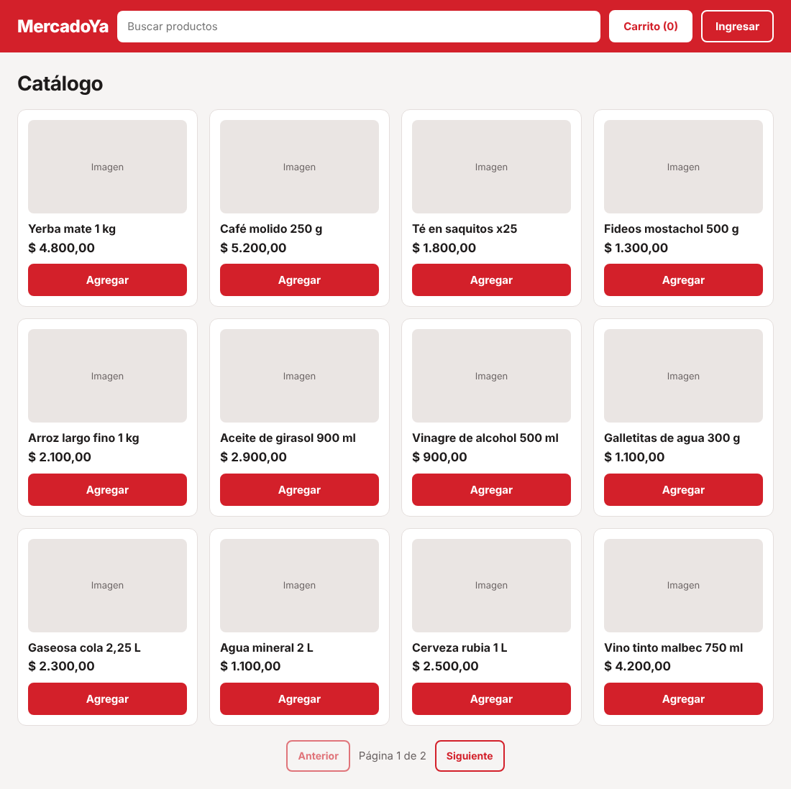
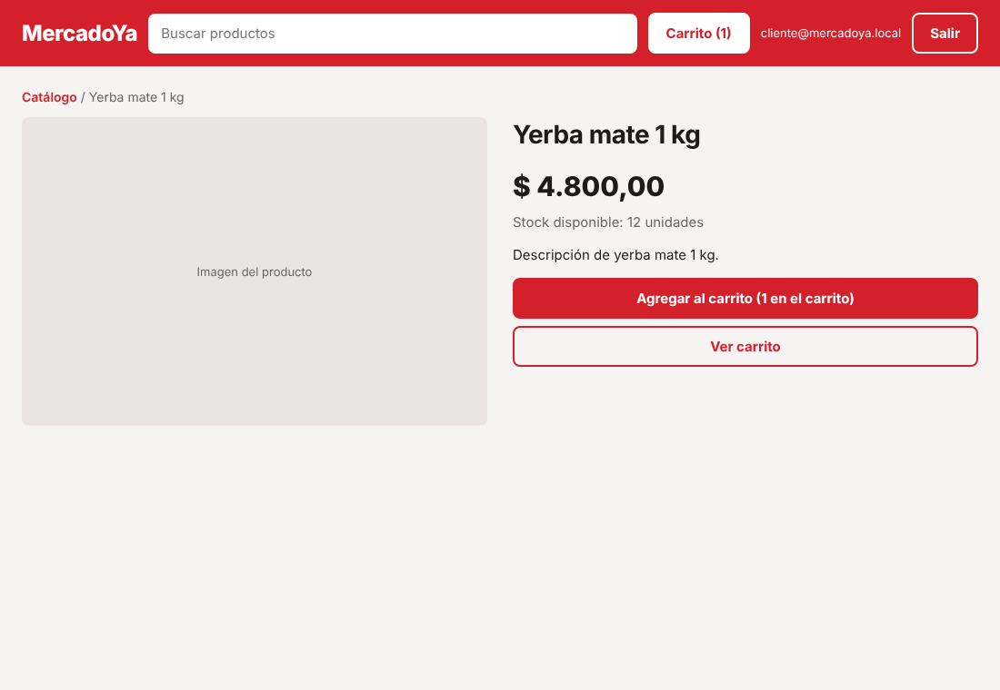
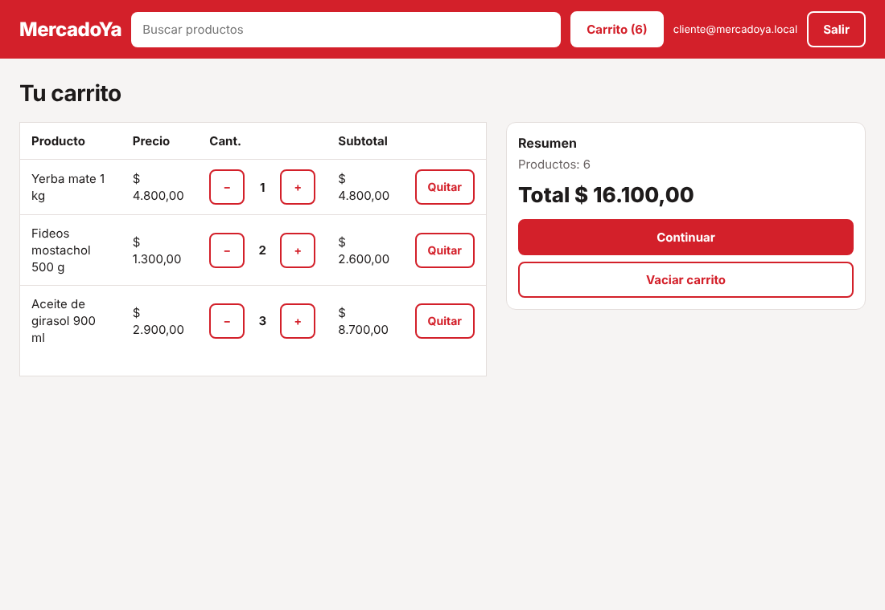
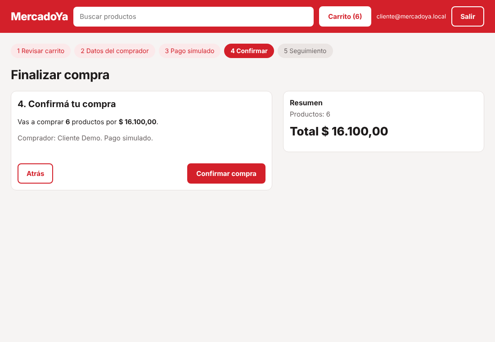
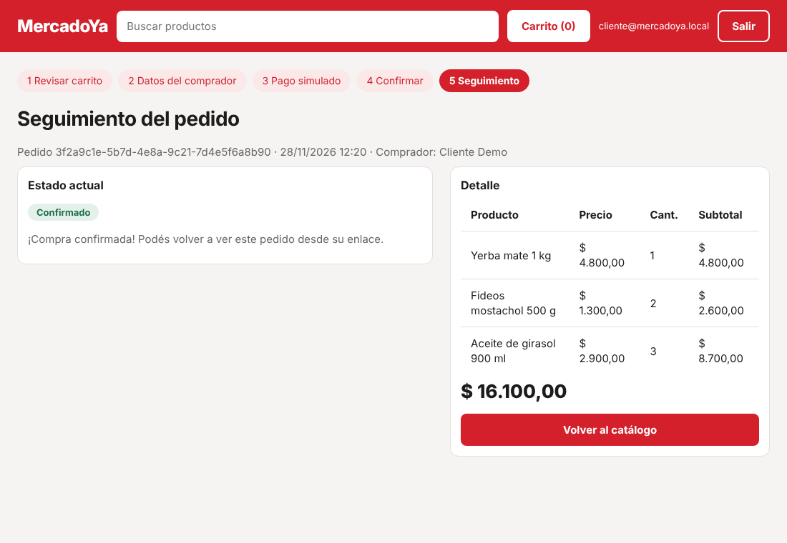
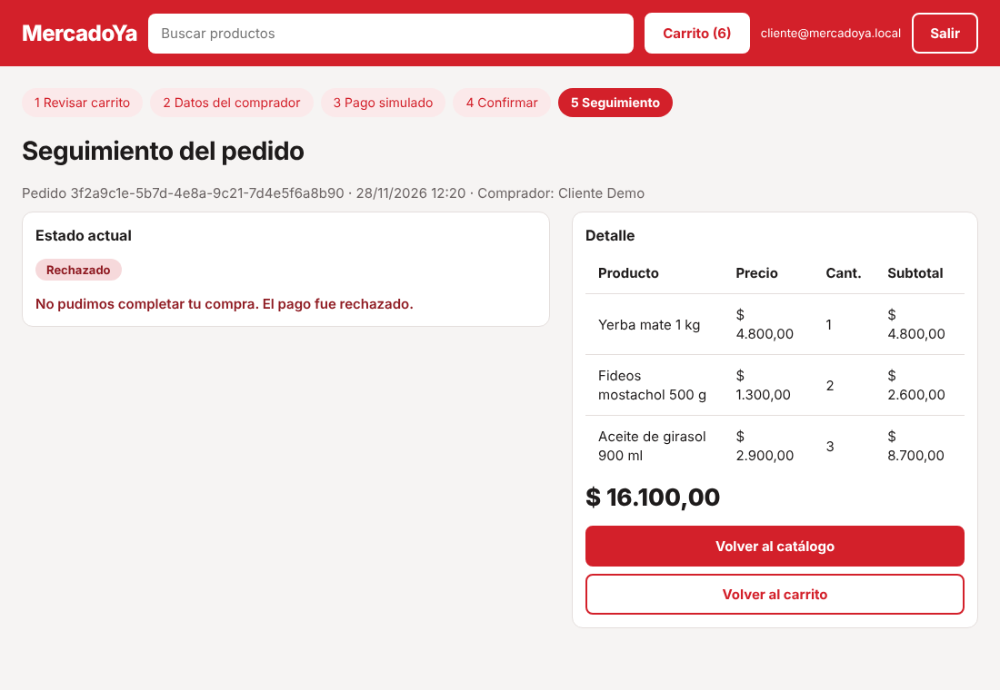
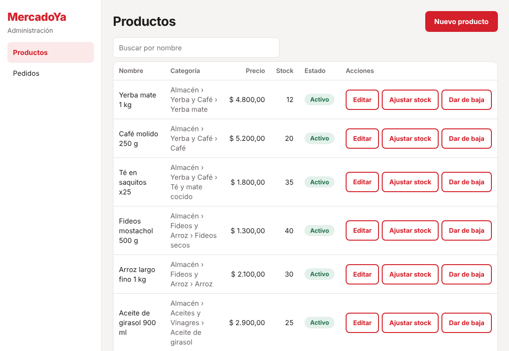
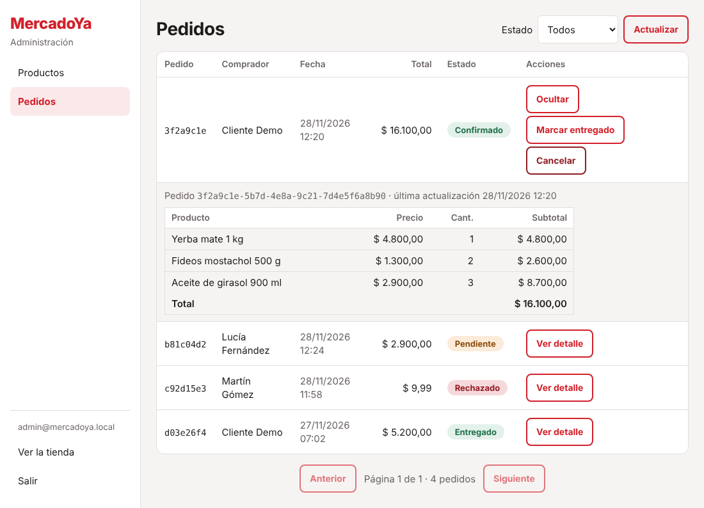

# MercadoYa — Manual de usuario

Guía para usar la tienda (clientes) y el panel de administración (administradores). Los textos entre comillas son los que muestra la pantalla.

**Contenido**

1. [Qué es MercadoYa](#1-qué-es-mercadoya)
2. [Cómo ingresar](#2-cómo-ingresar)
3. [Guía del cliente](#3-guía-del-cliente)
4. [Guía del administrador](#4-guía-del-administrador)
5. [Mensajes y problemas frecuentes](#5-mensajes-y-problemas-frecuentes)
6. [Preguntas frecuentes](#6-preguntas-frecuentes)

## 1. Qué es MercadoYa

Consiste en un catálogo web de comercio de barrio con un panel de administración. Los **clientes** buscan productos, arman un carrito y compran con un **pago simulado** (no se cobra dinero real ni se piden datos de tarjeta). Los **administradores** cargan y editan productos, controlan el stock y gestionan los pedidos.

| Perfil | Qué puede hacer |
|---|---|
| **Visitante** (sin sesión) | Ver el catálogo, buscar, ver el detalle de un producto y armar el carrito |
| **Cliente** | Todo lo anterior, más comprar y seguir sus pedidos |
| **Administrador** | Panel de administración: productos, stock y pedidos |

## 2. Cómo ingresar

| Qué | Dirección |
|---|---|
| Tienda y panel de administración | <http://localhost:3000> |

Si el sistema no está levantado, se inicia con un solo comando desde la carpeta del proyecto (ver el [README](../README.md)):

```bash
docker compose up -d --build
```

**Usuarios de prueba**

| Perfil | Usuario | Contraseña |
|---|---|---|
| Cliente | `cliente@mercadoya.local` | `Cliente123!` |
| Administrador | `admin@mercadoya.local` | `Admin123!` |

**Iniciar sesión.** Se hace con el botón **Ingresar** (arriba a la derecha). Te lleva a la pantalla de acceso del sistema de identidad (Keycloak); después de ingresar volvés a la tienda. Arriba aparece tu correo y el botón **Salir**.

**Crear una cuenta de cliente.** En la pantalla de acceso, elegí la opción de registro (*Register*), completá nombre, apellido, correo y contraseña. Las cuentas nuevas son siempre de **cliente**; las de administrador las crea el equipo técnico.

**Sesión vencida.** Si tu sesión caduca mientras usás la tienda, aparece arriba la barra "Tu sesión venció. Volvé a iniciar sesión para seguir donde estabas." con el botón **Ingresar**. Tu carrito no se pierde.

## 3. Guía del cliente

### 3.1 Ver el catálogo y buscar



- La pantalla inicial es el **Catálogo**: una grilla con la imagen, el nombre, el precio y el botón **Agregar** de cada producto.
- **Buscar:** escribí en el campo "Buscar productos" de la barra superior. Los resultados se actualizan solos. La búsqueda no distingue mayúsculas ni tildes: "cafe" encuentra "Café".
- **Paginar:** abajo están los botones **Anterior** y **Siguiente** ("Página 1 de 2").
- Si no hay coincidencias ves "No encontramos productos para …" con el botón **Ver todo el catálogo**.
- Un producto sin stock muestra el botón deshabilitado **Sin stock**.

### 3.2 Ver un producto



Al hacer clic en el nombre de un producto se abre su detalle: precio, descripción y "Stock disponible: N unidades". Desde ahí se agrega al carrito (**Agregar al carrito**) y, si ya hay unidades agregadas, aparece **Ver carrito**. Con **Catálogo** en la ruta de arriba volvés al listado.

### 3.3 Armar el carrito



- El botón **Carrito (N)** de la barra superior muestra cuántos productos llevás.
- En el carrito cambiás la cantidad con **−** y **+**, quitás un producto con **Quitar** o vaciás todo con **Vaciar carrito**.
- No se puede superar el stock disponible: ves "No hay más stock disponible."
- El carrito se guarda en tu navegador (por usuario): no hace falta iniciar sesión para armarlo.
- **Continuar** lleva al checkout. Si no iniciaste sesión, te pide ingresar y después vuelve al mismo punto.
- Comprar es una función de **cliente**: un usuario administrador puede armar el carrito, pero al continuar ve la pantalla de acceso denegado. Para comprar, usá una cuenta de cliente.

### 3.4 Comprar: el checkout en 5 pasos

El checkout muestra el avance arriba: **Revisar carrito → Datos del comprador → Pago simulado → Confirmar → Seguimiento**.

| Paso | Qué hacer |
|---|---|
| 1. Revisá tu carrito | Comprobar productos, cantidades y total. **Modificar el carrito** permite volver atrás |
| 2. Datos del comprador | Se muestran el nombre, el correo y el usuario con los que iniciaste sesión. No hay que escribir nada |
| 3. Pago | "Pago simulado. No se cobra dinero real ni se piden datos de tarjeta." |
| 4. Confirmá tu compra | Resumen: "Vas a comprar N productos por $ …". Apretá **Confirmar compra** |
| 5. Seguimiento | Se abre solo con el estado del pedido (ver 3.5) |

Se puede ir hacia atrás en cualquier paso con **Atrás**. Mientras el pedido se envía, el botón dice "Procesando…" y queda deshabilitado, así que un doble clic no genera dos compras.



### 3.5 Seguir el pedido

La compra **no se resuelve al instante**: el sistema la procesa en segundo plano (reserva el stock y simula el cobro) y la pantalla de seguimiento se actualiza sola **cada segundo**. Normalmente tarda pocos segundos.

Mientras se procesa, el pedido figura **Pendiente**:


Cuando termina, la misma pantalla se actualiza con el resultado:



| Estado | Significa | Qué ves |
|---|---|---|
| **Pendiente** | El pedido se está procesando | "Estamos procesando tu pedido… Se actualiza solo cada 1 segundo." |
| **Confirmado** | Stock reservado y pago aprobado | "¡Compra confirmada! Podés volver a ver este pedido desde su enlace." |
| **Rechazado** | No se pudo completar la compra | "No pudimos completar tu compra." más el motivo (ver abajo) |
| **Entregado** | El administrador marcó el pedido como entregado | "Tu pedido fue entregado." |
| **Cancelado** | El administrador canceló el pedido | "El pedido fue cancelado." |

La pantalla también muestra el detalle (productos, precios, cantidades y total). **Guardá el enlace de la página**: con él podés volver a ver tu pedido cuando quieras.

**Motivos de rechazo**

| Mensaje | Qué pasó | Qué hacer |
|---|---|---|
| "No había stock suficiente de alguno de los productos." | Otro cliente compró antes las últimas unidades | Volver al carrito, ajustar o elegir otro producto |
| "El pago fue rechazado." | El pago simulado rechazó el importe | Reintentar o consultar con el comercio |
| "El servicio de pagos no está disponible en este momento." | El servicio de pagos no responde | Probar de nuevo en unos minutos |
| "No pudimos verificar el stock. Probá de nuevo en unos minutos." | El servicio de stock no respondió | Probar de nuevo en unos minutos |
| "No pudimos procesar el pedido en este momento. Probá de nuevo." | El sistema de mensajería no estaba disponible al crear el pedido | Probar de nuevo |



Cuando un pedido termina **Rechazado**, **el carrito se restaura** con lo que habías elegido, para que puedas reintentar con **Volver al carrito**. En un rechazo no se descuenta stock ni se cobra.

**Si el pedido tarda más de lo normal.** Si pasan unos 30 segundos sin resultado, la pantalla avisa: "Tu pedido sigue en proceso y está tardando más de lo normal. No se perdió: actualizá el estado en unos instantes." y muestra el botón **Actualizar estado**. El pedido **no se pierde**: sigue en proceso y se resuelve apenas el sistema se normaliza. Si se cortó tu conexión, la pantalla avisa "Se perdió la conexión, reintentando." y sigue intentando sola.

### 3.6 Probar un pago rechazado (demostración)

El cobro es simulado y tiene una regla fija para poder probar el rechazo: **se rechazan los totales cuyos centavos terminan en 999** (por ejemplo **$ 9,99**, $ 19,99 o $ 129,99); el resto se aprueba. Para una demostración, el administrador crea un producto de **$ 9,99** (ver 4.2) y el cliente compra una unidad: el pedido termina **Rechazado** con "El pago fue rechazado." y el stock vuelve a su valor original.

## 4. Guía del administrador

Iniciá sesión con el usuario administrador. Aparece el botón **Panel admin** en la barra superior (o entrá a `/admin`). Un usuario sin rol de administrador que intente entrar ve la pantalla de acceso denegado (403).

El panel tiene un **menú lateral** con **Productos**, **Pedidos**, **Ver la tienda** y **Salir**.

### 4.1 Productos



La lista muestra nombre, categoría, precio, stock y estado (**Activo** o **Inactivo**) de cada producto, con búsqueda por nombre y paginación.

| Acción | Cómo | Resultado |
|---|---|---|
| **Buscar** | Escribir en "Buscar por nombre" | Filtra la lista |
| **Editar** | Botón **Editar** | Abre el formulario con los datos actuales |
| **Ajustar stock** | Botón **Ajustar stock** → ingresar un número (por ejemplo `10` o `-2`) → **Aplicar** | Suma o resta unidades. Muestra "Quedará en N" antes de aplicar. No permite dejar el stock en negativo |
| **Dar de baja** | Botón **Dar de baja** y confirmar | El producto deja de verse en la tienda ("quedó inactivo"). Los pedidos ya hechos no cambian |
| **Reactivar** | Botón **Reactivar** en un producto inactivo | Vuelve a estar a la venta |

### 4.2 Crear o editar un producto

Con **Nuevo producto** (o **Editar**) se abre el formulario:

| Campo | Regla |
|---|---|
| **Nombre** (obligatorio) | Hasta 150 caracteres |
| **Descripción** | Hasta 2000 caracteres |
| **Precio ($)** (obligatorio) | Mayor a 0, con hasta 2 decimales |
| **Stock inicial** (obligatorio, solo al crear) | Número entero entre 0 y 100.000. Después se cambia con **Ajustar stock** |
| **Categoría** (obligatorio) | Se elige de la lista de categorías |
| **URL de la imagen** | Opcional; debe empezar con `http://` o `https://`. Muestra una vista previa |
| **Activo** | Si está marcado, el producto se ve en la tienda |

Los errores se marcan en cada campo ("Revisá los datos marcados"). Al terminar, **Crear producto** o **Guardar cambios**.

### 4.3 Pedidos



La lista muestra el pedido (los primeros 8 caracteres de su identificador), el comprador, la fecha, el total y el estado, con paginación.

- **Filtrar:** el selector **Estado** permite ver Todos o solo Pendiente, Confirmado, Rechazado, Entregado o Cancelado. **Actualizar** vuelve a consultar.
- **Ver detalle:** muestra el identificador completo, la última actualización, los productos con precios y cantidades y, si fue rechazado, el motivo ("Rechazado: Sin stock suficiente", "Pago rechazado", etc.).
- **Cambiar el estado:** solo los pedidos **Confirmados** tienen botones de acción:
  - **Marcar entregado:** el pedido pasa a Entregado.
  - **Cancelar:** el pedido pasa a Cancelado y **se libera el stock reservado**. Pide confirmación y no se puede deshacer.

Los pedidos **Pendientes** todavía los está procesando el sistema y no se pueden modificar. Si ves uno por mucho tiempo, consultá a soporte técnico (ver [`mensajeria.md`](mensajeria.md#8-la-cola-de-mensajes-muertos-ordersdead)).

**Recorrido de un pedido:** nace **Pendiente** y lo resuelve el sistema: pasa a **Confirmado** (pago aprobado) o a **Rechazado** (estado final). Solo desde Confirmado interviene el administrador: **Entregado** o **Cancelado** (estados finales).

## 5. Mensajes y problemas frecuentes

| Mensaje | Causa probable | Qué hacer |
|---|---|---|
| "No pudimos conectar con el servidor. Revisá tu conexión y probá de nuevo." | Sin conexión o el sistema no está levantado | Revisar la conexión y reintentar. La web reintenta sola las lecturas |
| "El servicio no está disponible en este momento. Probá de nuevo en unos minutos." | Un servicio está caído o reiniciándose | Esperar unos minutos y usar **Reintentar** |
| "Tu sesión venció. Volvé a iniciar sesión para seguir donde estabas." | La sesión caducó | Apretar **Ingresar** |
| "Tu usuario no tiene permiso para hacer esto." / pantalla de acceso denegado | Entraste a una sección que no corresponde a tu perfil | Volver a la tienda; para el panel hace falta el perfil de administrador |
| "Algo salió mal" con el botón **Reintentar** | Falló la carga del catálogo | Apretar **Reintentar** |
| "Todavía no hay productos a la venta" | El catálogo está vacío | Volver más tarde |
| "No hay más stock disponible." | Pediste más unidades de las que hay | Reducir la cantidad |
| "Producto no encontrado" | El producto no existe o ya no está a la venta | Volver al catálogo |
| "Pedido no encontrado" | El pedido no existe o no es de tu cuenta | Volver al catálogo |

## 6. Preguntas frecuentes

**¿Se cobra dinero de verdad?** No. El pago es simulado: no se piden datos de tarjeta ni se mueve dinero.

**Confirmé la compra y dice "Pendiente". ¿Falló?** No. La compra se procesa en segundo plano y casi siempre se resuelve en pocos segundos; la pantalla se actualiza sola. Si tarda más de 30 segundos, usá **Actualizar estado**: el pedido no se pierde.

**¿Puedo cerrar la página mientras el pedido está Pendiente?** Sí. El pedido sigue procesándose. Volvé a abrir el enlace del pedido para ver el resultado.

**Mi pedido fue rechazado. ¿Se me descontó algo?** No. Si el pedido se rechaza, el stock reservado se devuelve y no hay cobro. El carrito se restaura para reintentar.

**Apreté dos veces "Confirmar compra". ¿Se compra dos veces?** No. El botón se deshabilita mientras se envía y, además, el sistema reconoce el reintento de la misma compra y no la duplica.

**¿Qué pasa si dos personas quieren comprar la última unidad?** Una la compra y la otra recibe un rechazo por falta de stock. Nunca se venden más unidades de las que hay.

**¿Dónde veo mis pedidos anteriores?** La tienda no tiene un historial de pedidos del cliente (queda fuera del alcance del proyecto). Cada pedido se consulta desde su enlace directo.

**Soy administrador y cancelé un pedido. ¿El stock vuelve?** Sí: al cancelar se libera el stock reservado y el catálogo se actualiza.
