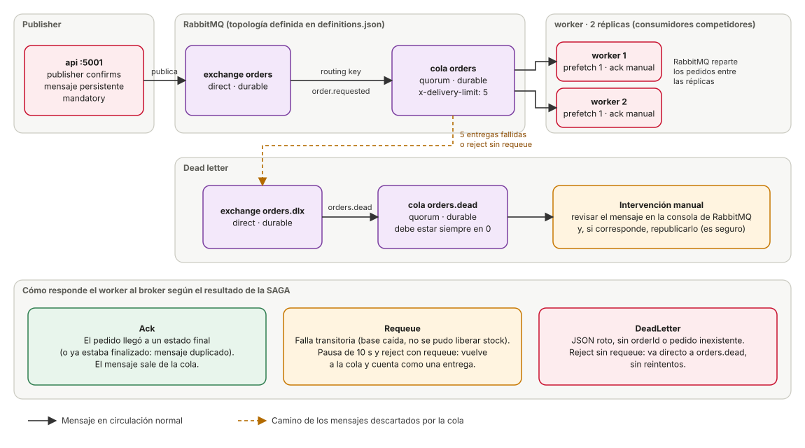

# MercadoYa — Mensajería con RabbitMQ

Cómo viaja un pedido de la `api` al `worker`: topología del broker, formato del mensaje, garantías de entrega, qué pasa cuando algo falla y cómo se opera.

**Documentos relacionados:** [`secuencia-checkout-saga.md`](./secuencia-checkout-saga.md) (qué hace el worker con cada mensaje) · [`consistencia-eventual.md`](./consistencia-eventual.md) · [`pruebas-de-fallo.md`](./pruebas-de-fallo.md) · `contracts/order-requested.json`.

## 1. Para qué se usa

El checkout publica **un solo tipo de mensaje**, `OrderRequested`, y un worker lo consume para ejecutar la SAGA. La mensajería aporta tres cosas:

- **Desacoplamiento:** la `api` responde `202 Accepted` sin esperar el cobro ni la reserva de stock.
- **Tolerancia a caídas:** si el worker o `payments` están caídos, el pedido espera en la cola y se procesa cuando vuelven.
- **Escalado:** se agregan réplicas del worker y RabbitMQ reparte los pedidos entre ellas.

## 2. Topología



**Cómo leerlo:** línea continua = recorrido normal de un mensaje; línea punteada = camino de los mensajes que la cola descarta (dead letter). Abajo se ve cómo responde el worker al broker según el resultado de la SAGA. Se edita igual que el diagrama de arquitectura: es un SVG (`mensajeria.svg`).

| Elemento | Tipo | Configuración |
|---|---|---|
| `orders` | Exchange `direct`, durable | Recibe lo que publica la `api` |
| `orders` | Cola **quorum**, durable | Enlazada a `orders` con la routing key `order.requested`. Argumentos: `x-delivery-limit: 5`, `x-dead-letter-exchange: orders.dlx`, `x-dead-letter-routing-key: orders.dead` |
| `orders.dlx` | Exchange `direct`, durable | Recibe los mensajes que la cola `orders` descarta |
| `orders.dead` | Cola quorum, durable | Enlazada a `orders.dlx` con la routing key `orders.dead`. Guarda los mensajes que requieren intervención manual |

**Dónde se define.** La topología no la crean las aplicaciones: vive en `infra/rabbitmq/definitions.json`, que RabbitMQ carga al arrancar (`load_definitions` en `infra/rabbitmq/rabbitmq.conf`). Así los nombres, los argumentos de las colas y el usuario `mercadoya` quedan versionados en el repositorio y son los mismos en cualquier máquina. Los nombres que usa el código están en `RabbitTopology` (`src/Modules/Pedidos/Messaging.cs`).

**Por qué cola quorum.** Replica los mensajes con consenso (Raft), los persiste en disco y es la que soporta `x-delivery-limit`, que es lo que corta los reintentos infinitos. Es la cola recomendada para datos que no se pueden perder.

## 3. El mensaje `OrderRequested`

```json
{
  "orderId": "3f2a9c1e-5b7d-4e8a-9c21-7d4e5f6a8b90",
  "userId": "<claim sub de Keycloak>",
  "items": [ { "productId": 1, "quantity": 2 } ],
  "totalCents": 960000
}
```

| Propiedad AMQP | Valor | Para qué |
|---|---|---|
| `persistent` | `true` | El mensaje se guarda en disco |
| `content-type` | `application/json` | JSON en camelCase |
| `message-id` | el `orderId` | Identifica el pedido en la consola de RabbitMQ y en los logs |
| `correlation-id` y header `X-Correlation-Id` | el id de correlación de la request HTTP | Sigue la compra de punta a punta: HTTP → mensaje → HTTP al stock y gRPC a `payments` |

**El mensaje es liviano a propósito.** Lleva los datos del pedido por si hacen falta, pero el worker **no los usa**: relee el pedido de la base y toma de ahí los ítems y el total. La base es la fuente de verdad; así un mensaje viejo, duplicado o alterado no puede cambiar lo que se reserva ni lo que se cobra.

## 4. Publicación (la `api`)

`RabbitOrderPublisher` publica con **publisher confirms**: `PublishAsync` solo termina bien cuando el broker confirma que guardó el mensaje.

- Mensaje persistente y publicación `mandatory`: si el exchange no tiene una cola enlazada, el broker lo devuelve y se produce un error en lugar de perder el mensaje en silencio.
- Espera de la confirmación: **5 s** como máximo.
- Una conexión y un canal para toda la vida de la `api`; si fallan, se recrean en el siguiente envío.
- **Si no se puede publicar** (broker caído, nack, timeout): el checkout marca el pedido **Rechazado (`BrokerNoDisponible`)** y responde **503**. No queda un pedido huérfano y el cliente recibe un error claro para reintentar. Se comprueba en `OrderSagaRabbitTests` (RabbitMQ caído) y `CheckoutAsyncTests`.

## 5. Consumo (el `worker`)

`OrderSagaWorker` consume la cola `orders` con esta configuración:

| Opción | Valor | Por qué |
|---|---|---|
| `prefetch` | **1** | Un mensaje a la vez por réplica: reparto parejo entre réplicas y un pedido no espera detrás de otro dentro del mismo worker |
| Confirmación | **Manual** (`autoAck: false`) | El `ack` se envía solo después de dejar el pedido en un estado final. Si el worker cae a mitad, RabbitMQ reentrega el mensaje |
| Réplicas | **2** (`deploy.replicas` en `docker-compose.yml`) | Consumidores competidores sobre la misma cola. Se puede cambiar al vuelo: `docker compose up -d --scale worker=3` |
| Reconexión | Cada **5 s** | Si RabbitMQ no está al arrancar o se cae, el worker reintenta; además la librería recupera sola la conexión y el consumidor ante cortes cortos |
| Nombre de conexión | `mercadoya-worker-<host>` | En la consola de RabbitMQ se ve una conexión por réplica |

## 6. Qué se hace con cada mensaje

Al terminar de procesarlo, la SAGA devuelve una de tres decisiones y el worker responde al broker:

| Decisión | Cuándo ocurre | Llamada al broker | Resultado |
|---|---|---|---|
| **Ack** | El pedido llegó a un estado final (Confirmado o Rechazado, con la compensación hecha), o ya estaba finalizado (mensaje duplicado) | `basic.ack` | El mensaje sale de la cola |
| **Requeue** | Falla transitoria: la base no responde, la liberación de stock no pudo hacerse | Pausa de **10 s** y `basic.reject` con `requeue: true` | Vuelve a la cola; cuenta como entrega fallida |
| **DeadLetter** | El mensaje nunca va a poder procesarse: JSON roto, sin `orderId` o pedido inexistente | `basic.reject` con `requeue: false` | Va directo a `orders.dead` por el DLX, sin reintentos |

**Reintentos acotados.** Cada devolución a la cola cuenta una entrega. Al llegar a `x-delivery-limit: 5`, RabbitMQ manda el mensaje solo a `orders.dlx` y de ahí a `orders.dead`. Con la pausa de 10 s son unos **50 s** de margen, más que los 30 s que el circuit breaker del stock queda abierto: una caída corta no manda pedidos a la cola de muertos.

**Por qué `reject` y no `nack`.** Desde RabbitMQ 4.3, un `basic.nack` con requeue **no suma** al límite de entregas, así que el mensaje se reintentaría para siempre. `basic.reject` sí cuenta como intento fallido. Está comprobado en `Si_la_compensacion_nunca_funciona_...`, que verifica que el mensaje termina en `orders.dead` tras 5 entregas.

## 7. Garantías de entrega

El sistema ofrece **entrega al menos una vez** (*at-least-once*): un mensaje puede llegar más de una vez, pero no se pierde.

| Riesgo | Cómo se evita |
|---|---|
| Se pierde el mensaje al publicarlo | Publisher confirms + `mandatory` + mensaje persistente + cola quorum durable |
| Se pierde porque el broker se reinicia | Cola y mensajes durables, en disco (volumen `rabbitdata`) |
| Se pierde porque el worker cae procesándolo | Ack manual: sin ack, vuelve a la cola |
| Se procesa dos veces (reentrega, dos réplicas a la vez) | **Idempotencia:** cambio de estado condicional (`WHERE Status = 'Pendiente'`), reserva única por pedido y cobro único por pedido. Repetir el mensaje no repite sus efectos |
| Un mensaje defectuoso bloquea la cola | Reintentos limitados (5) y después `orders.dead` |

Es la combinación habitual: *at-least-once* en el transporte más consumidores idempotentes dan un resultado equivalente a "exactamente una vez".

## 8. La cola de mensajes muertos (`orders.dead`)

Debería estar **siempre en 0**. Un mensaje allí es un caso que la SAGA no pudo resolver sola:

| Causa | Estado del pedido | Qué hacer |
|---|---|---|
| JSON ilegible o pedido inexistente | — | Revisar el contenido y descartarlo |
| Compensación que no funcionó (no se pudo liberar el stock) | Rechazado, con stock aún reservado | Liberar el stock (operación idempotente) y descartar el mensaje |
| Base no disponible durante las 5 entregas | Pendiente | Resolver la causa y volver a publicar el mensaje |

Para inspeccionarla: consola de RabbitMQ (`http://localhost:15672`, usuario `mercadoya`; contraseña de desarrollo en el compose) → **Queues** → `orders.dead` → **Get messages**. Para volver a publicar un mensaje: **Exchanges** → `orders` → **Publish message**, con routing key `order.requested` y el JSON original. Es seguro repetirlo por la idempotencia. El procedimiento completo con ejemplos está en [`pruebas-de-fallo.md`](./pruebas-de-fallo.md#3-cómo-leer-ordersdead).

## 9. Operación y diagnóstico

```powershell
# Estado de las colas: mensajes pendientes y consumidores (esperado: orders 0 mensajes y 2 consumidores; orders.dead 0)
docker compose exec rabbitmq rabbitmqctl list_queues name messages consumers

# Logs de las réplicas del worker (una línea por evento, con el CorrelationId y el OrderId)
docker compose logs -f worker

# Seguir un pedido a través de api, worker y payments
docker compose logs | Select-String "<correlationId>"

# Agregar una réplica
docker compose up -d --scale worker=3
```

En la consola de RabbitMQ (**Queues**) se ve en vivo cuántos mensajes hay, los consumidores conectados (uno por réplica) y la tasa de entrega.

## 10. Cómo se probó

Seis tests de integración contra un RabbitMQ real (Testcontainers, la misma topología de `definitions.json`), en `OrderSagaRabbitTests`:

| Test | Qué demuestra |
|---|---|
| Pedido publicado con el worker apagado | La cola durable lo conserva; se confirma al arrancar el worker |
| Mensaje ilegible | Va directo a `orders.dead`, sin reintentos |
| Compensación que nunca funciona | Reintentos hasta el límite de 5 entregas y luego `orders.dead` |
| Dos workers | Reparto sin duplicados: cada pedido se procesa una sola vez |
| Worker que se apaga a mitad de un pedido | El mensaje no se pierde y otra réplica lo termina |
| RabbitMQ caído | El publisher falla enseguida y no queda nada publicado |

Se ejecutan con `dotnet test` (necesitan Docker); para saltearlos: `dotnet test --filter "Category!=Integracion"`.

