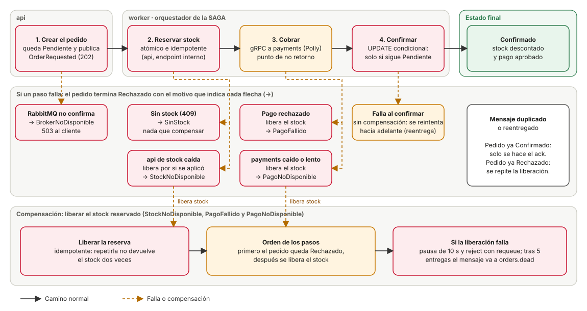
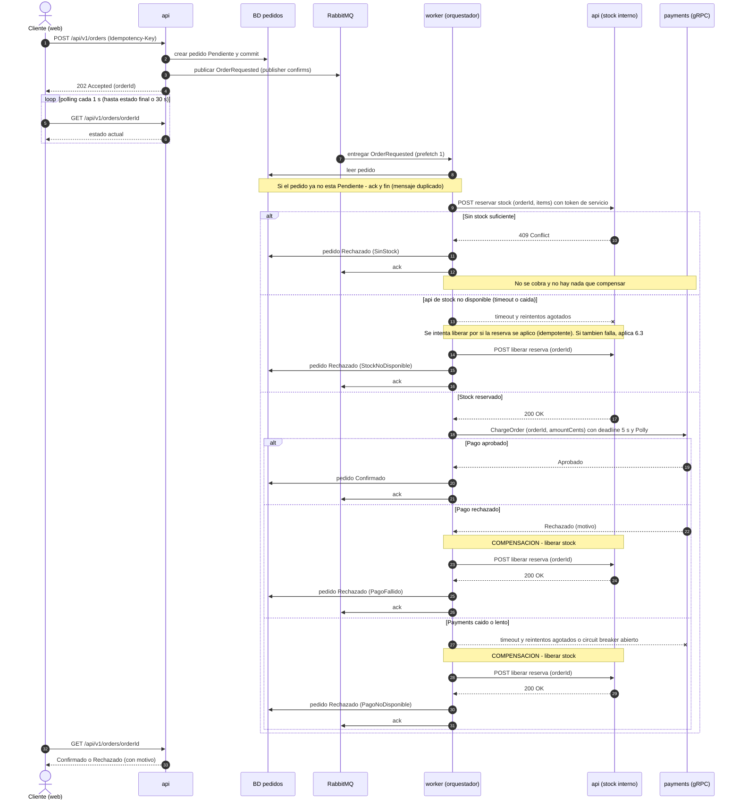
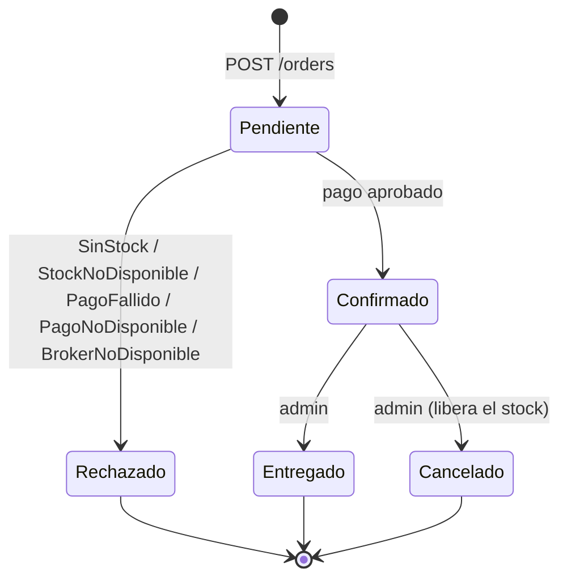
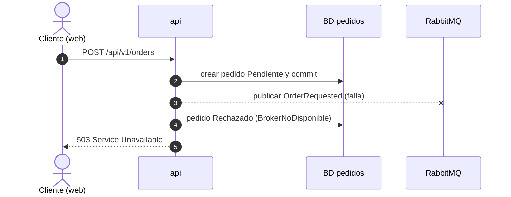
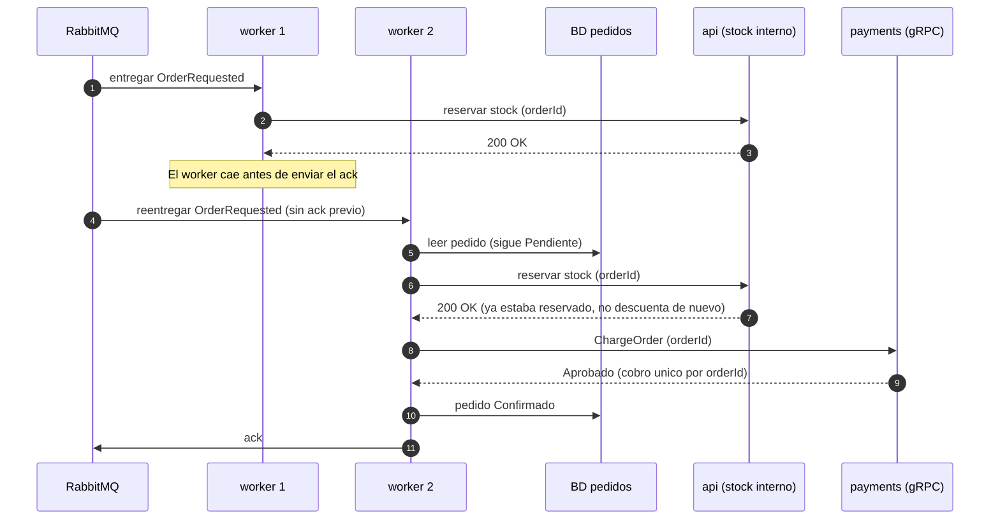

# MercadoYa — Secuencia del checkout con SAGA y compensaciones

> **Estado:** implementado y verificado (SAGA orquestada por el `worker`, ver `OrderSagaProcessor` en `src/Modules/Pedidos/OrderSaga.cs`). Este documento describe el diseño y lo que hace el código.
> **Historial:** la v2 agregó el escenario de falla de la reserva de stock (`StockNoDisponible`), el de falla al confirmar tras cobrar y las pruebas 9 y 10.
> **Documentos relacionados:** [`arquitectura-general.md`](./arquitectura-general.md) · [`consistencia-eventual.md`](./consistencia-eventual.md) · [`mensajeria.md`](./mensajeria.md) · [`pruebas-de-fallo.md`](./pruebas-de-fallo.md) · carpeta `contracts/`.

## 1. Qué resuelve este flujo

Comprar en MercadoYa involucra tres recursos que viven en lugares distintos: el **pedido** (módulo Pedidos), el **stock** (módulo Inventario) y el **cobro** (servicio `payments`, con su propia base de datos). No hay una transacción de base de datos que abarque los tres, así que la consistencia se logra con una **SAGA**: una secuencia de pasos locales, cada uno con una acción de **compensación** que deshace sus efectos si un paso posterior falla.

**Tipo de SAGA: orquestada.** El `worker` es el orquestador: conoce el orden de los pasos y decide qué compensar. Se eligió orquestación (y no coreografía por eventos) porque el flujo es corto y lineal, el estado queda centralizado y es más fácil de probar y de explicar en la defensa.

## 2. Participantes

| Participante | Rol en la SAGA |
|---|---|
| **Cliente (web)** | Inicia la compra y consulta el estado por polling |
| **api** | Crea el pedido Pendiente, publica el mensaje y expone el stock interno |
| **BD pedidos** | Guarda el pedido y su estado (esquema `pedidos`) |
| **RabbitMQ** | Entrega `OrderRequested` de forma durable |
| **worker** | Orquestador: ejecuta pasos y compensaciones |
| **payments** | Cobro simulado idempotente por gRPC |

## 3. Pasos, compensaciones e idempotencia

| Paso | Acción | Compensación | Idempotencia |
|---|---|---|---|
| 1 | Crear el pedido en estado Pendiente y publicar `OrderRequested` | Marcar el pedido Rechazado | Header `Idempotency-Key` (índice único por usuario y clave) |
| 2 | Reservar stock (todos los ítems en una sola transacción) | Liberar la reserva | `StockReservation` única por `orderId` y producto: repetir devuelve 200 sin descontar de nuevo |
| 3 | Cobrar por gRPC (**punto de no retorno**) | No hay reembolso en el pago simulado | `PaymentRecord` único por `orderId`: repetir devuelve el mismo resultado |
| 4 | Confirmar el pedido | — | La actualización de estado solo aplica si el pedido sigue Pendiente |

Una vez que el pago está aprobado se pasa el *pivote* de la SAGA: a partir de ahí ya no se compensa hacia atrás, solo se reintenta hacia adelante hasta confirmar. Como el cobro es idempotente, reintentar es seguro.

### Vista general

El diagrama resume los pasos, qué falla en cada uno y qué se compensa. Los diagramas de secuencia siguientes muestran el detalle de los mensajes (es un SVG: `saga-checkout.svg`).

## 4. Diagrama de secuencia completo

Incluye el camino feliz y las compensaciones posibles dentro del worker (sin stock, `api` de stock no disponible, pago rechazado y `payments` no disponible).

## 5. Estados del pedido

La cancelación por parte del administrador no pasa por la SAGA: la `api` libera el stock directamente con la misma operación idempotente de liberación.

## 6. Fallos de infraestructura

### 6.1 RabbitMQ caído al crear el pedido

No queda un pedido huérfano: se marca Rechazado y el cliente recibe un error claro para reintentar.

### 6.2 El worker cae a mitad del procesamiento (reentrega)

Si el mismo mensaje llegara de nuevo con el pedido ya Confirmado, el worker lo reconoce por el estado, envía el ack y termina sin repetir efectos.

### 6.3 Falla de la propia compensación

Al rechazar un pedido, el worker **primero** lo deja Rechazado (con su motivo) y **después** libera el stock. Si la liberación falla (por ejemplo, `api` no disponible momentáneamente), el worker **no confirma** el mensaje y lo devuelve a la cola. En la reentrega ve el pedido ya Rechazado y repite solo la liberación; como es idempotente, repetirla es seguro. Este orden evita que, si el worker cae entre ambos pasos, un pedido ya compensado se vuelva a reservar o cobrar. Tras `x-delivery-limit` (5) entregas fallidas el mensaje va al DLX y a la cola `orders.dead` para intervención manual: el pedido figura Rechazado y lo único pendiente es devolver el stock (la cola muerta lo deja a la vista). Un mensaje ilegible o de un pedido inexistente va directo a `orders.dead`, sin reintentos.

## 7. Tabla resumen de escenarios

| Escenario | Qué ocurre | Compensación | Estado final |
|---|---|---|---|
| Camino feliz | Reserva y cobro correctos | — | **Confirmado** |
| Sin stock | La reserva responde 409 | Nada (no se reservó ni cobró) | **Rechazado** (SinStock) |
| `api` de stock caída o lenta | Timeout y reintentos agotados al reservar | Liberar (idempotente) por si la reserva se aplicó | **Rechazado** (StockNoDisponible) |
| Pago rechazado | `payments` devuelve Rechazado | Liberar stock | **Rechazado** (PagoFallido) |
| `payments` caído o lento | Timeout, reintentos y circuit breaker | Liberar stock | **Rechazado** (PagoNoDisponible) |
| RabbitMQ caído al crear | La publicación falla | Marcar el pedido Rechazado | **Rechazado** (BrokerNoDisponible), 503 al cliente |
| Worker o RabbitMQ caídos tras el 202 | Cola durable conserva el mensaje | — | **Pendiente**, luego se resuelve |
| Falla al confirmar tras cobrar | La actualización a Confirmado falla (BD no disponible) | Ninguna: se reintenta hacia adelante | **Pendiente** y luego **Confirmado**: el mensaje se reentrega y el cobro idempotente devuelve el mismo resultado |
| Mensaje duplicado | Idempotencia por estado, reserva y pago | — | Se procesa una sola vez |
| Dos compras del último stock | Reserva atómica: una gana | Ninguna para la ganadora | Una **Confirmado**, la otra **Rechazado** (SinStock) |
| Falla la compensación | Reintentos y, luego, DLX | — | **Rechazado**; el stock queda por devolver a mano (el mensaje en `orders.dead` lo deja a la vista) |

## 8. Resiliencia aplicada a las llamadas del worker

Implementada con Polly (`Resilience.cs`). Un mismo pipeline, compartido por todos los mensajes, protege cada dependencia: reintentos (afuera) → circuit breaker → timeout por intento (adentro).

| Parámetro | Valor |
|---|---|
| Timeout por intento | 5 s |
| Reintentos | 3, con backoff exponencial (base 0,5 s) y jitter |
| Circuit breaker | Se abre si fallan al menos la mitad de las llamadas de los últimos 30 s (mínimo 5 llamadas); permanece abierto 30 s y luego prueba una llamada (semiabierto) |
| Qué se reintenta | Caídas de red, timeouts, 5xx, 408 y 429. **No** se reintentan los 4xx, el "sin stock" (409) ni el pago rechazado: son respuestas válidas o errores que fallarían igual |
| Por qué es seguro reintentar | Reservar, liberar y cobrar son idempotentes por pedido |
| Circuito abierto | Falla enseguida, sin llamar al servicio caído y sin gastar los 5 s de timeout |
| Pago caído (reintentos agotados o circuito abierto) | `PagoNoDisponible`: se libera el stock y se rechaza el pedido |
| Stock caído | `StockNoDisponible`; si la liberación falla se reencola (pausa de 10 s) |
| Ack del mensaje | Manual, solo al llegar a un estado final del flujo |
| Consumo | `prefetch 1`; 2 réplicas del worker como consumidores competidores (`deploy.replicas` en `docker-compose.yml`) |

Los cambios de estado del pedido son condicionales (`UPDATE ... WHERE Status = 'Pendiente'`), así que dos réplicas que reciban el mismo pedido no lo finalizan dos veces.

## 9. Consistencia

- **Stock:** consistente. La reserva usa una actualización atómica del tipo `UPDATE ... SET stock = stock - n WHERE stock >= n` dentro de una transacción, de modo que nunca se vende dos veces el mismo stock.
- **Resultado del pedido:** eventualmente consistente. Entre el `202 Accepted` (paso 4) y el estado final hay una ventana en la que el pedido figura Pendiente. La web la cubre con polling.
- **Prioridad ante particiones:** el diseño prefiere la **integridad del stock y la coherencia final del pedido** antes que dar una respuesta inmediata; por eso el checkout es asíncrono y ante fallos rechaza o espera en lugar de aceptar ventas sin respaldo.

## 10. Limitaciones conocidas y mejoras

| Limitación | Detalle | Mejora posible |
|---|---|---|
| Ventana entre commit y publicación | Si la `api` cae justo después de guardar el pedido y antes de publicar, el pedido queda Pendiente sin mensaje | Patrón **Outbox** o un job que republique pedidos Pendiente antiguos |
| Sin reembolso | El pago es simulado, así que no existe compensación del cobro | Paso de reembolso en `payments` si el pago fuese real |
| Orquestador único lógico | Todo el conocimiento del flujo está en el worker | Aceptable por la simplicidad; es la contracara de elegir orquestación |

## 11. Pruebas de la SAGA

Escenarios para probar la SAGA. Para cada tipo de falla, cómo ejecutarlo a mano y qué test automático lo cubre: [pruebas-de-fallo.md](pruebas-de-fallo.md).

1. Compra exitosa de punta a punta.
2. Compra de un producto sin stock.
3. Pago rechazado: verificar que el stock vuelve a su valor original.
4. Detener `payments` durante una compra: verificar reintentos, circuit breaker, compensación y estado `PagoNoDisponible`.
5. Detener RabbitMQ y crear un pedido: verificar el 503 y el estado `BrokerNoDisponible`.
6. Detener el worker, crear pedidos y volver a levantarlo: verificar que se procesan.
7. Dos compras simultáneas del último stock: solo una se confirma.
8. Reenviar el mismo mensaje: verificar que no hay doble descuento ni doble cobro.
9. Detener `api` (o bloquear `/internal/v1/stock`) durante el procesamiento: verificar reintentos y estado `StockNoDisponible` sin stock descontado.
10. Provocar un fallo al confirmar el pedido tras el cobro: verificar que el mensaje se reentrega y termina Confirmado sin doble cobro.
